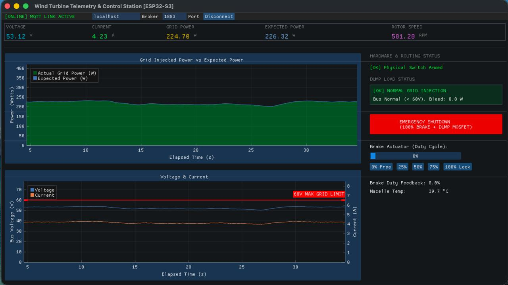

# Wind Turbine Control & Ground Station Telemetry

Real-time distributed control system and telemetry platform built with C++ (ESP32-S3, FreeRTOS, OpenGL/ImGui), MQTT, and Python to regulate and monitor a wind turbine designed for a turbine competition and eventual deployment on remote Scottish farms.

## Why I Built This

I built the control firmware and ground-station software for a wind turbine competing in a collegiate competition, with the long-term goal of deploying reliable, low-maintenance power generation on remote Scottish farms. Wind gusts in off-grid environments can rapidly spike generator bus voltage past safe grid-inverter limits, so the system needs deterministic overvoltage protection alongside live remote monitoring and manual override controls.

On the ESP32-S3, I pinned a 100 Hz FreeRTOS PID voltage regulator (`Kp = 5.0`, `Ki = 1.2`, `Kd = 0.5`) to Core 1 with an exponential moving average filter (`alpha = 0.15`) to drive a 20 kHz dump-load MOSFET (`GPIO 18`) whenever bus voltage exceeds the `58.0 V` setpoint. Sensor acquisition runs without blocking the control loop: a dedicated Core 0 FreeRTOS task polls a PZEM-017 power monitor over RS485 Modbus (`UART2`)—starting with an initial blocking read in `setup()` so the PID initializes with true bus voltage—while an `IRAM_ATTR` GPIO interrupt with a 3 ms debounce measures wind speed from the anemometer and a `DHT11` tracks nacelle temperature and humidity.

For off-board monitoring and control, the ESP32-S3 hosts a standalone Wi-Fi SoftAP (`192.168.4.1`) connected to a local Mosquitto MQTT broker (`192.168.4.2:1883`), streaming 10 Hz JSON telemetry on `turbine/telemetry` and listening on `turbine/control/#` for live setpoint updates and emergency stops. On the desktop side, I built a native C++ ground-station client using OpenGL, ImGui, and ImPlot that auto-spawns an embedded Mosquitto broker, maintains a 60-second (`600`-sample) thread-safe ring buffer, plots actual vs. expected power and bus voltage/current, and provides brake duty sliders and a latched software E-stop—paired with a physics-based Python turbine emulator to test the full stack before hardware integration.

## What I Built

- **100 Hz FreeRTOS PID Voltage Regulator (`voltage_regulator.cpp`):** High-priority control task pinned to Core 1 with anti-windup integral clamping, EMA voltage filtering, mutex-protected dynamic thresholds, and 20 kHz LEDC PWM dump-load modulation.
- **Multi-Sensor Embedded Acquisition (`voltage.cpp`, `anemometer.cpp`, `temp_humid.cpp`):** Background Core 0 RS485 Modbus polling for PZEM-017 voltage, current, and power; hardware-interrupt pulse counting (`IRAM_ATTR` + critical sections) for anemometer wind speed; and DHT11 nacelle environmental monitoring.
- **Standalone Wi-Fi SoftAP & MQTT Control Node (`main.cpp`):** Self-contained `192.168.4.1` access point publishing 10 Hz JSON telemetry frames and executing `ArduinoJson` callbacks for real-time overvoltage threshold adjustments and 100% dump-load E-stops.
- **C++ OpenGL/ImGui Ground Station (`gui_app.cpp`, `mqtt_client.cpp`, `telemetry_state.hpp`, `embedded_broker.cpp`):** Desktop telemetry monitor with an auto-managed Mosquitto process, lock-protected ring buffers, live ImPlot time-series graphs (comparing actual grid power against the `0.00067 * RPM²` expected curve), shunt/dump load status indicators, brake duty controls, and latched E-stop overrides.
- **Python Turbine Physics Simulator (`simulator.py`):** Multi-threaded MQTT emulator modeling wind turbulence, rotor inertia, voltage/current curves, thermal dissipation, and physical/software E-stop states to validate the ground station prior to bench and field runs.
